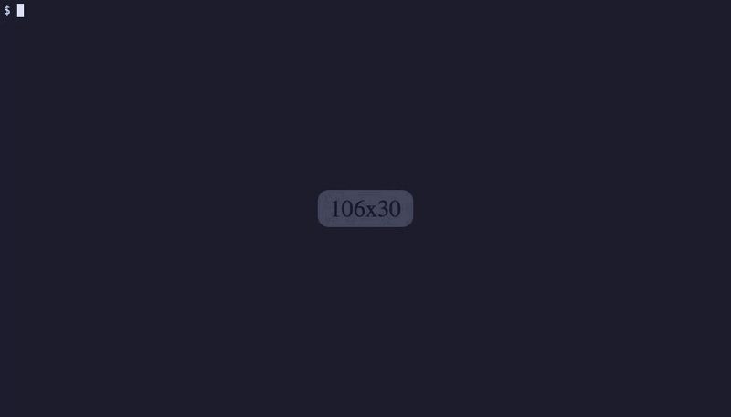

# InduSense — Industrial IoT Monitoring Platform

Event-driven monitoring for a fictional German manufacturer: sensor telemetry over MQTT and Kafka, rule-based, statistical and Isolation Forest anomaly detection, alerts and incidents, a live Next.js dashboard. Python (FastAPI), PostgreSQL, InfluxDB, Redis, Kubernetes/Helm.




## Results

All numbers: one laptop, Docker Desktop. Full log in [docs/verification.md](docs/verification.md).

| What | Result | Source |
|---|---|---|
| Tests | 148 passed, 8 skipped (131 unit, 6 contract, 8 integration, 3 e2e), fresh volumes | `make unit-test` and the other test targets, 13 Oct 2026 |
| Kubernetes | 15 pods Ready on kind; seed, simulator, alerts and Prometheus counters verified | [docs/verification.md](docs/verification.md) |
| Dashboard load | 50 VUs, 5,416 requests, 0% failed, p95 65 ms | k6 `dashboard-read-load.js` |
| WebSockets | 250/250 sessions connected and closed cleanly, 2 runs (after a server fix, see verification log) | k6 `websocket-scale.js` |
| Rate limit | 30 of 60 logins rejected with 429 (limit 30/min) | k6 `auth-rate-limit.js` |
| Alert latency | MQTT to alert in REST API: mean 74 ms, p95 250 ms (n=8) | [FINAL_REPORT](eval/results/FINAL_REPORT.md), earlier run |
| Throughput | stream-processor ceiling 385 msg/s per instance; 127,374-message burst, zero loss | [FINAL_REPORT](eval/results/FINAL_REPORT.md), earlier run |
| CI | last run on `main` (12 Sep 2026): all jobs passed | GitHub Actions |
| Grafana | 31 of 32 dashboard queries return data under load; the other is "Failed messages", empty when nothing fails | [docs/verification.md](docs/verification.md) |
| Dependencies | `pip-audit` clean for all 8 requirement files; frontend lint and build pass | [docs/verification.md](docs/verification.md) |

## Architecture

```text
Simulator ─MQTT→ Mosquitto → Ingestion ─→ Kafka ─┬→ Stream processor → InfluxDB (+Redis dedup)
                                                 ├→ Anomaly detector (rules, EWMA z-score, Isolation Forest)
                                                 └→ Alert service → PostgreSQL (alerts, incidents)
                                         FastAPI REST + WebSocket → Next.js dashboard
                                         Prometheus + Grafana + Jaeger
```

Delivery is at-least-once with idempotent consumers; the gaps are listed in [docs/delivery-semantics.md](docs/delivery-semantics.md).

## Quickstart

```bash
make setup && make up     # infra, migrations, services, frontend (health-checked)
make seed                 # demo data: 4 factories, 200 devices, 1000 sensors, 5 alert rules
make simulate-docker      # generate MQTT traffic
```

Dashboard http://localhost:3000, API http://localhost:8080 (Swagger at `/docs`), Kafka UI :8089. Demo login `admin@musterfabrik-gmbh.de` / `ChangeMe123!` (local development only). Tests: `make unit-test contract-test integration-test e2e-test`. Run e2e on fresh volumes (`make clean` first).

## Kubernetes

Helm chart in `infrastructure/helm/indusense`, images loaded locally. The exact kind commands and observed results are in [docs/verification.md](docs/verification.md).

## Grafana and alerting

Five dashboards are provisioned (IoT, Kafka, Platform, Anomaly & Alerting, Overview); Grafana runs on :3001 under Compose. Rules, thresholds, severities, cooldown, escalation and the incident workflow: [docs/alerting.md](docs/alerting.md).

## Evaluation

Isolation Forest was written from scratch; design and results in [docs/ANOMALY-DETECTION.md](docs/ANOMALY-DETECTION.md). End-to-end evaluation (loss, latency, failure injection): [eval/results/FINAL_REPORT.md](eval/results/FINAL_REPORT.md).

## Go to Python rewrite

The backend was first built in Go (phases 1–16), then rewritten service by service in Python so the author can read and defend all of it. Each service was verified against real infrastructure before its Go code was removed. No Go remains. Details: [docs/phases/17-python-rewrite.md](docs/phases/17-python-rewrite.md); per-phase notes in [docs/phases/](docs/phases/README.md).

## Limitations

- Single-machine measurements only; no multi-node or cloud run.
- Kubernetes checked on kind only. Ingress, persistence across restart, rolling upgrades and multi-node behaviour are unverified.
- The "Failed messages per service" Grafana panel is empty when no messages fail; that is expected, not a broken panel.
- Delivery is at-least-once; a duplicate arriving after the dedup TTL (default 3600 s) is processed again.
- Data is simulated; no real sensors.
- The last run on `main` is from 12 Sep 2026; the October changes were validated on a pull request branch, not yet on `main`.

## Repository

`services/` five Python services · `shared/` common code · `simulator/` · `frontend/` · `migrations/` · `infrastructure/` (Helm, Grafana, Prometheus) · `load-tests/` (k6) · `tests/` · `eval/` · `docs/`
